# AVA Space Wars

[](https://github.com/Harlock123/AVASpaceWars/actions/workflows/build.yml)

A two-ship duel in glowing vector lines, in the style of Cinematronics' 1977 arcade game **Space
Wars**, built with .NET 10 and Avalonia UI. The needle and the wedge fight it out around a sun that
pulls them in. Each has thrust, torpedoes and a jump to hyperspace, with only so much fuel and only so
many torpedoes. Play the computer round by round, or a friend on the same keyboard.

## Features

- **Newtonian flying**: turn, thrust and coast. Nothing slows you down but your own engine, and the sun bends every path. Run out of fuel and you drift.
- **Torpedoes**:
  - **The rack:** twenty per ship, five in flight at most. They fly straight and die away after a second and a half.
  - **Friendly fire:** in wrapping space a torpedo can come round and hit the ship that fired it.
- **Hyperspace**: vanish, then reappear somewhere else a moment later. It costs fuel, and every jump after the first in a life risks blowing up the ship. Each loss counts as a point for the other side.
- **Five arenas**, one per round in the one-player game:
  - **The Sun:** a sun in the middle that pulls everything in and burns up whatever it catches.
  - **Open Space:** no sun at all.
  - **The Box:** the sun again, but the edges bounce you back instead of wrapping.
  - **Heavy Star:** a sun that pulls twice as hard.
  - **Black Hole:** you can't see it, but it pulls just the same.
- **One player**: rounds against a computer pilot, first to three points. The computer gets sharper each round: quicker to react, truer in its aim and its lead, and readier to dodge or jump. Win a round for a bonus and the next arena. Lose one and it costs a ship, and the round starts again.
- **Two players**: needle against wedge on one keyboard, or on two gamepads. First to seven wins.
- **Scoring** in the one-player game:
  - 500 points a kill, plus 100 for each round past the first
  - 1,000 times the round number for winning it
  - an extra ship at 20,000 points and every 30,000 after that
- **Vector graphics**: every line glows like a beam on a vector monitor.
  - Ships come apart line by line when hit, and the sun's rays flicker.
  - In wrapping space a ship near an edge shows on the far side too.
- **Sound**: a low hum of space during the duel, plus torpedoes, thrust, explosions, the warp of hyperspace, and a sun that screams as it swallows a ship. All of it is synthesised and mixed by OpenAL.
- **Attract mode**: leave the title alone for 15 seconds and two computer pilots fight it out, arena after arena.
- **A top-ten high-score table** with arcade-style initials entry. It records the round reached.
- **Any window size**: the screen scales to fit, letterboxed. **Ctrl+S** saves a screenshot.
- **One self-contained executable** per platform: Windows, macOS and Linux on Intel/AMD and ARM.

## Screenshots

| The title | A round begins | The Sun |
|:---------:|:--------------:|:-------:|
| 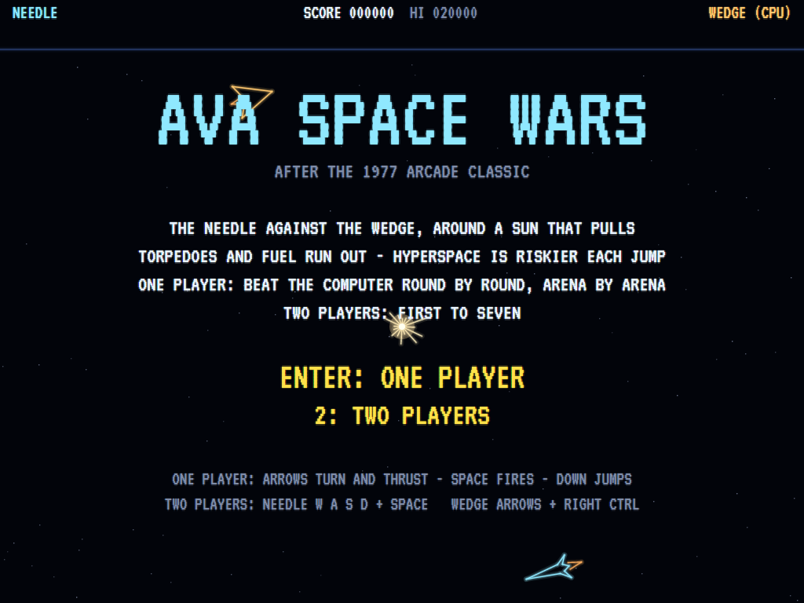 | 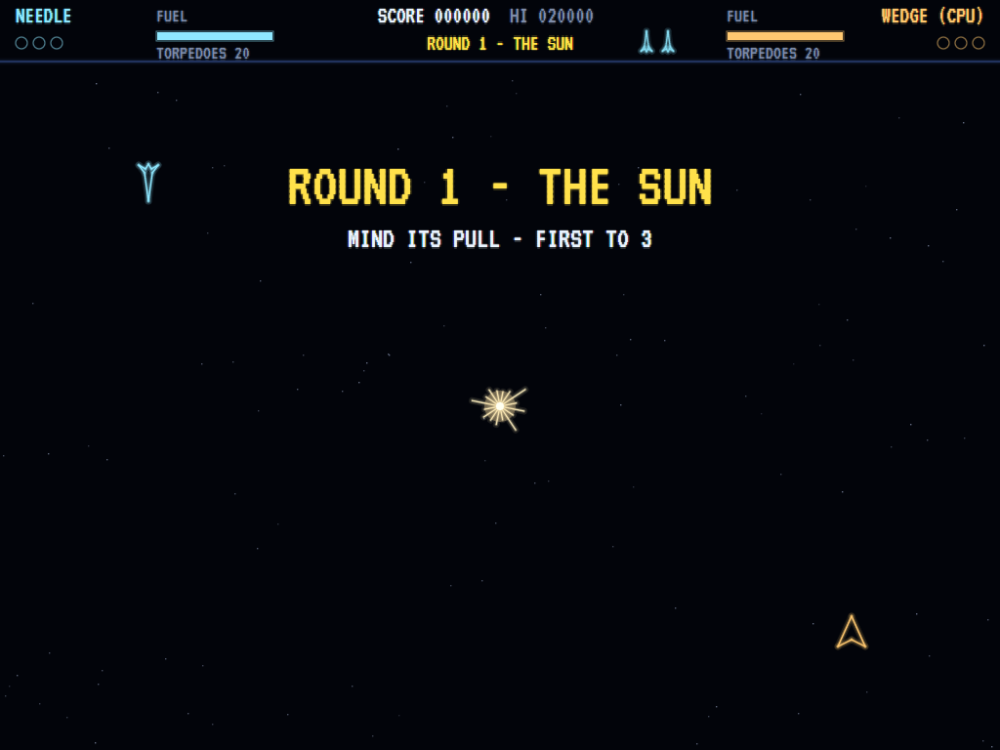 | 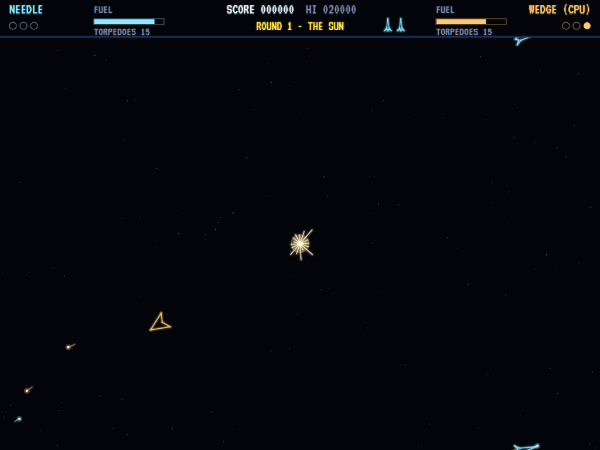 |
| Needle and wedge circling. | Round one, and its rules. | Torpedoes across the sun. |

| A hit | Hyperspace | Open Space |
|:-----:|:----------:|:----------:|
| 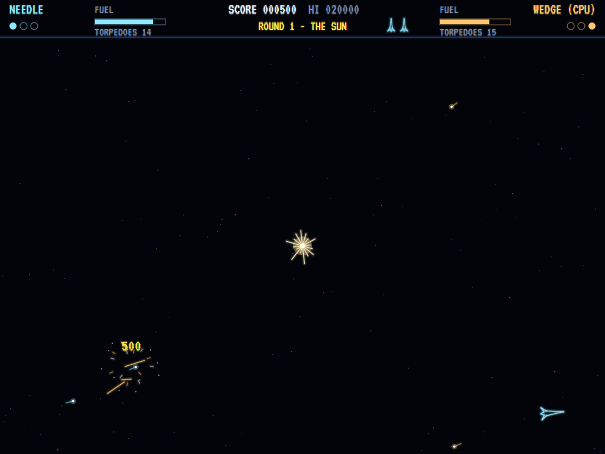 | 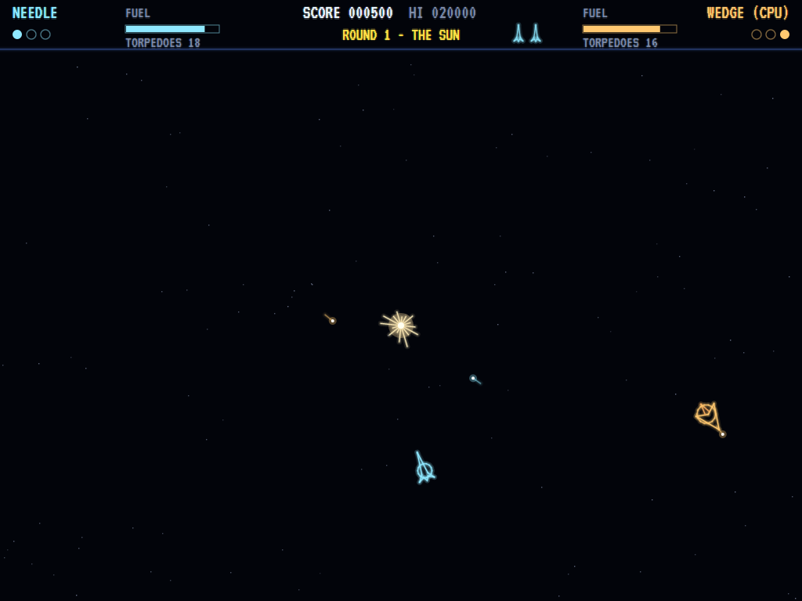 | 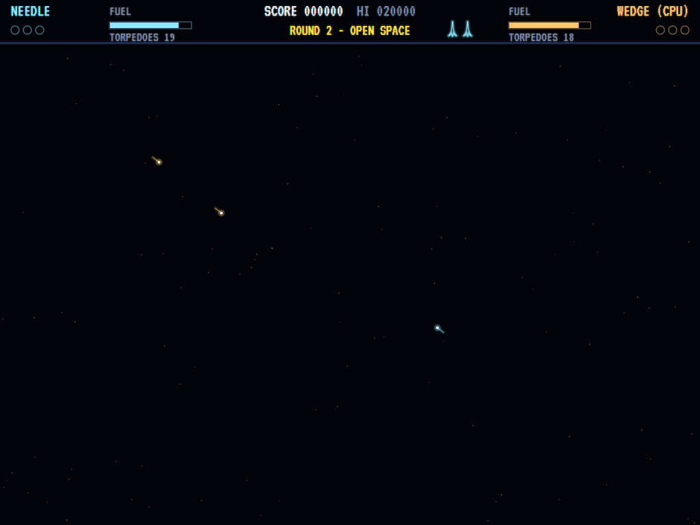 |
| The wedge comes apart. | Back from the jump. | No sun at all. |

| The Box | Heavy Star | Black Hole |
|:-------:|:----------:|:----------:|
| 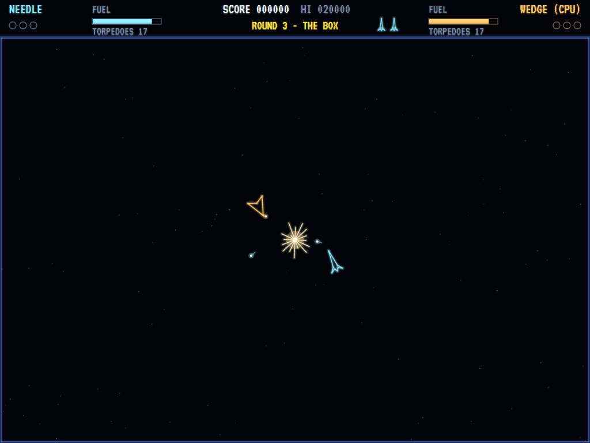 | 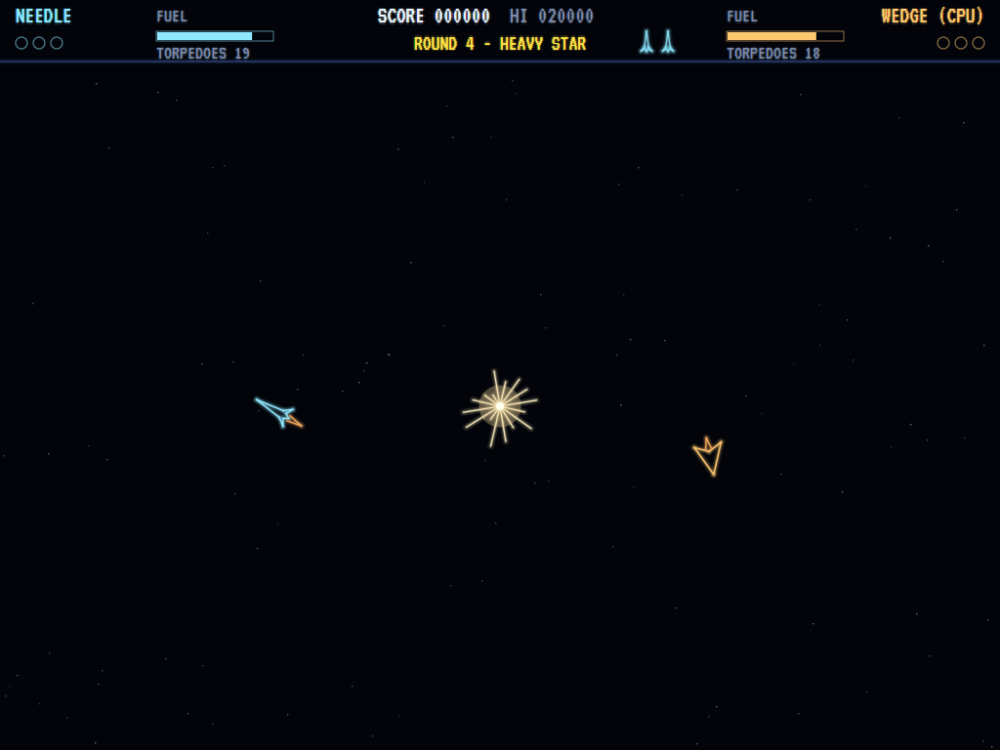 | 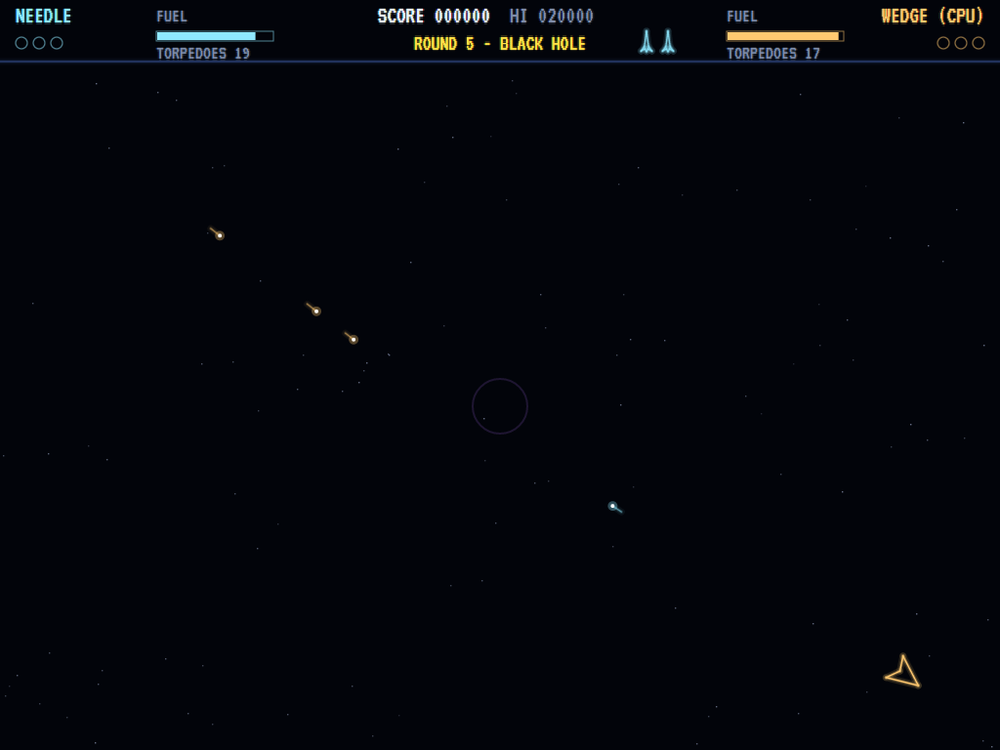 |
| Edges that bounce. | Twice the pull. | Unseen, but there. |

| Round over | Two players | The best duellists |
|:----------:|:-----------:|:------------------:|
| 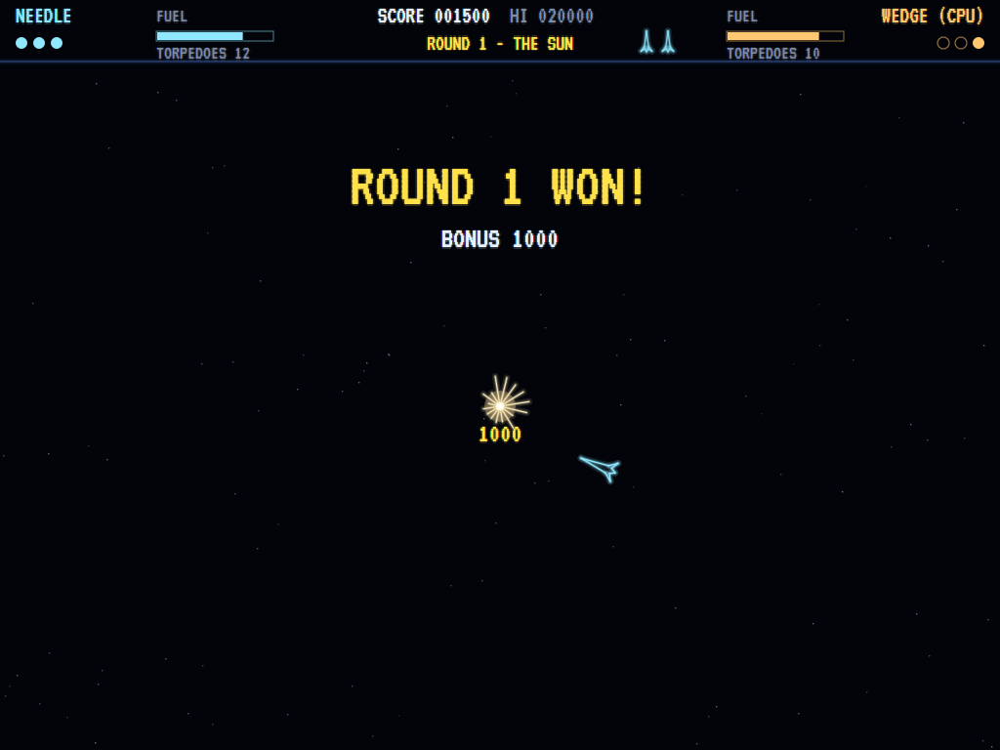 | 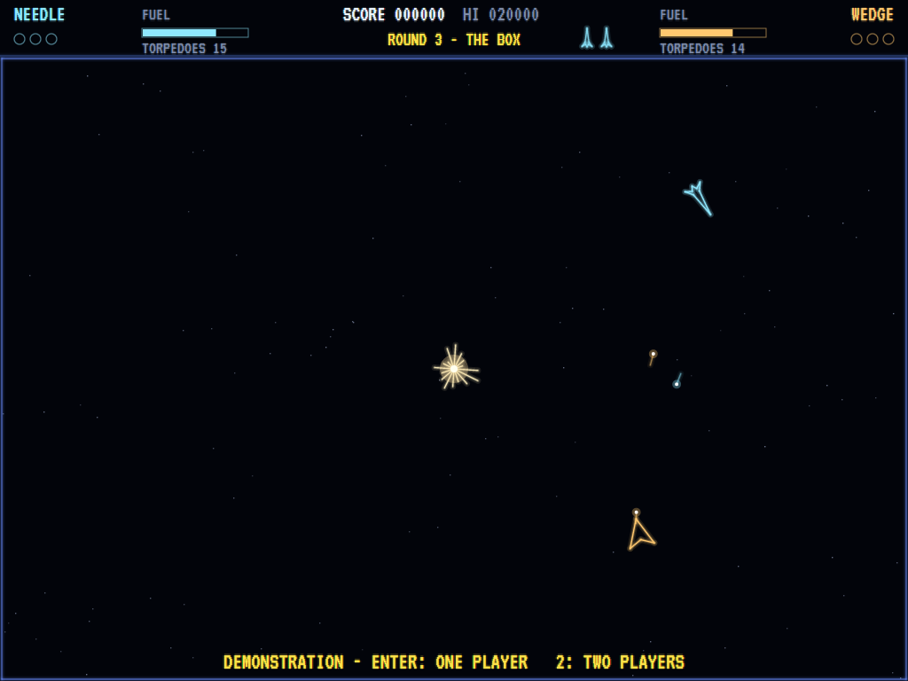 | 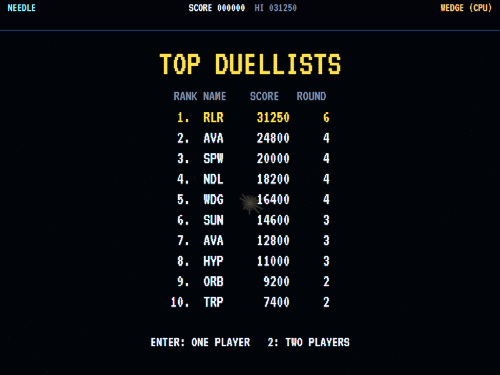 |
| Three points take it. | First to seven. | The high-score table. |

The screenshots are made by the tests, which play the game in a real (headless) window; see
[Tests](#tests).

## Download and run

Ready-to-run builds for Windows, macOS and Linux, on both Intel/AMD and ARM, are on the
[Releases page](https://github.com/Harlock123/AVASpaceWars/releases/tag/latest). **Latest build** is
rebuilt on every push to `main`. Each download is one self-contained executable: no .NET install is
needed.

| Platform | Archive |
|---|---|
| Windows | `AVASpaceWars-win-x64.zip`, `AVASpaceWars-win-x86.zip`, `AVASpaceWars-win-arm64.zip` |
| macOS | `AVASpaceWars-osx-arm64.tar.gz` (Apple silicon), `AVASpaceWars-osx-x64.tar.gz` (Intel) |
| Linux | `AVASpaceWars-linux-x64.tar.gz`, `AVASpaceWars-linux-arm64.tar.gz`, `AVASpaceWars-linux-arm.tar.gz` |

```bash
tar -xzf AVASpaceWars-linux-x64.tar.gz     # or linux-arm64, linux-arm, osx-arm64, osx-x64
./AVASpaceWars
```

On Windows, unzip and run `AVASpaceWars.exe`. On macOS, if Gatekeeper refuses to open it, run
`xattr -d com.apple.quarantine AVASpaceWars` once. Run with `--no-audio` for silence.

**Sound** comes through OpenAL Soft, built in for every platform. In a virtual machine the game
detects it and uses a larger audio buffer, so the sound doesn't break up.

**Gamepads** use SDL2, which is bundled for Windows, macOS and Intel/AMD Linux. ARM Linux builds need it
installed; without it the keyboard still works:

```bash
sudo apt install libsdl2-dev            # Debian / Ubuntu / Raspberry Pi OS
sudo pacman -S --needed sdl2-compat     # Arch / Omarchy
```

## Controls

| One player | Action |
|-------|--------|
| **Enter** / **1** | Start a one-player game |
| **Left** / **Right** (or **A** / **D**) | Turn |
| **Up** / **W** | Thrust |
| **Space** / **Z** / **Ctrl** | Fire |
| **Down** / **S** / **X** / **Shift** | Hyperspace |

| Two players | Needle | Wedge |
|-------|--------|-------|
| **2** to start | | |
| Turn | **A** / **D** | **Left** / **Right** |
| Thrust | **W** | **Up** |
| Fire | **Space** / **Left Ctrl** | **Right Ctrl** / **Numpad 0** / **/** |
| Hyperspace | **S** / **Left Shift** | **Down** / **Right Shift** |

**P** / **Esc** pause (Esc again to quit), **M** mutes, **Ctrl+S** saves a screenshot to the Pictures
folder.

**Gamepads**: the first flies the needle and the second the wedge. Stick or D-pad left and right to
turn, up or the right trigger to thrust, **A** or **X** to fire, **B**, **Y** or D-pad down for
hyperspace. **Start** on the first pad starts a one-player game, and on the second a two-player game.

**Entering initials**: type letters, or dial with **Up**/**Down** and accept with **Space**; **Left** /
**Backspace** go back; **Enter** finishes.

## Tests

```bash
dotnet test AVASpaceWars.slnx
```

The engine has no UI and runs in fixed 60 Hz steps, so it plays the same at any frame rate, and a seed
always plays the same game. The tests check:

- **Flying:** turning, thrust and coasting with nothing to slow you, fuel burning and running dry, wrapping and bouncing edges
- **The sun:** its pull (twice as strong for the heavy star, none in open space), and the point it gives the other ship when it burns one up
- **Torpedoes:**
  - the firing rate, how many can be in flight, and how long they last
  - the rack running dry
  - a hit scoring for the shooter
  - a ship safe from its own torpedo as it leaves, but not later
  - collisions destroying both ships and scoring for neither
- **Hyperspace:** the ship going and coming back elsewhere for its fuel, the first jump being safe, and the risk that grows until one fails
- **Rounds:**
  - three points winning a round, with its bonus and the next arena
  - a lost round costing a ship, and the last one ending the game
  - the two-player duel to seven with no high score
  - the extra ship
- **The machine:** the computer keeping out of the sun and hunting the needle, the attract cycle, the same game from the same seed, initials and the high-score file

The screenshot tests draw the real screen in a headless window. To refresh the README's pictures:

```bash
SPACEWARS_SHOTS=$PWD/Images dotnet test tests/AVASpaceWars.Tests --filter ScreenshotTests
```

To see how the computer pilots fare against each other, arena by arena and skill by skill (for tuning):

```bash
SPACEWARS_PROBE=1 dotnet test tests/AVASpaceWars.Tests --filter PilotProbe --logger "console;verbosity=detailed"
```

## Building

```bash
dotnet build AVASpaceWars.slnx
dotnet run --project src/AVASpaceWars
```

Needs the .NET 10 SDK. The sounds are made by `tools/make_sounds.py` (standard-library Python):
`python3 tools/make_sounds.py` rewrites `src/AVASpaceWars/Sounds`.

## Project structure

```
AVASpaceWars/
├── AVASpaceWars.slnx
├── src/AVASpaceWars/
│   ├── Engine/
│   │   ├── GameEngine.cs        # States, one and two players, the title and demo cycle
│   │   ├── GameEngine.Play.cs   # Flying, the sun's pull, torpedoes, hyperspace, collisions,
│   │   │                        # points, rounds and arenas, scoring and ships
│   │   ├── DuelPilot.cs         # The computer pilot, with its skill
│   │   ├── Entities.cs          # Ships, torpedoes, debris and the five arenas
│   │   ├── HighScoreTable.cs, InitialsEntry.cs
│   │   ├── InputHandler.cs, ControllerManager.cs  # The split keyboard and two SDL2 gamepads
│   │   └── SoundManager.cs      # Effects, the hum and the tunes through OpenAL
│   ├── Audio/                   # The OpenAL engine (from the author's AVABand)
│   ├── Views/                   # The vector-beam drawing, the score bar and the screens
│   └── Sounds/                  # The synthesised effects and tunes
├── tests/AVASpaceWars.Tests/    # Gameplay, screenshot and probe tests
├── tools/make_sounds.py
└── Images/                      # Screenshots
```

## About and licence

AVA Space Wars © 2026 Lonnie Watson, under the [MIT License](LICENSE).

*Space Wars* © 1977 Cinematronics; the name belongs to its current owner. AVA Space Wars is an
independent, unofficial game in its style. Its ships, arenas, computer pilot, graphics, sounds, tunes
and code are its own; nothing is taken from the arcade machine's program, graphics or sound. It is not
affiliated with or endorsed by any rights holder.
